<div align="center">

# Apple67

### Stop screenshotting plans. Start making them.

Turn a place you found into a night out: **create a party, swipe to decide, share the ride, split the bill, get home.**

[](https://autonomous-sg.vercel.app)

[](LICENSE)


**Discover together. Decide together. Go together.**

Free to use · MIT licensed · Singapore-first

[Live demo](https://autonomous-sg.vercel.app) · [Quick start](#quick-start) · [How it works](#how-a-night-out-works) · [Architecture](#architecture) · [Business model](#the-business-opportunity-help-interest-become-action) · [Known limits](#7-known-limits)

<br>

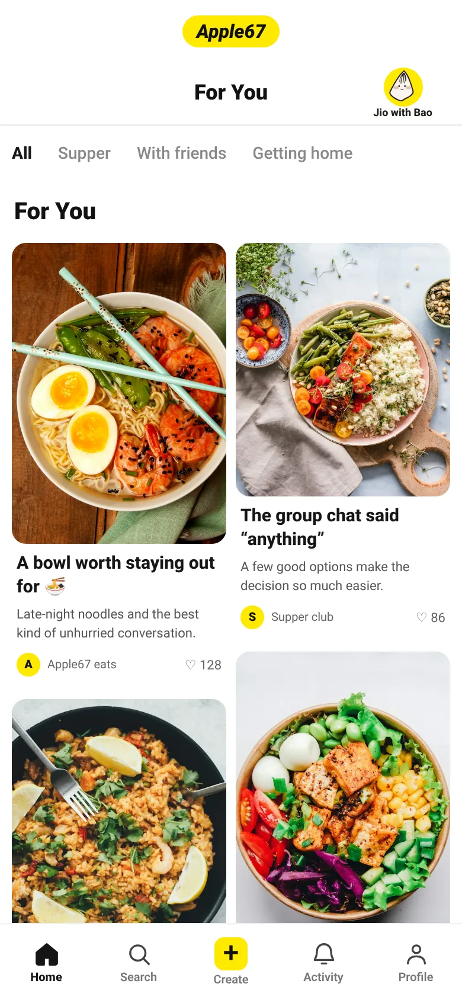 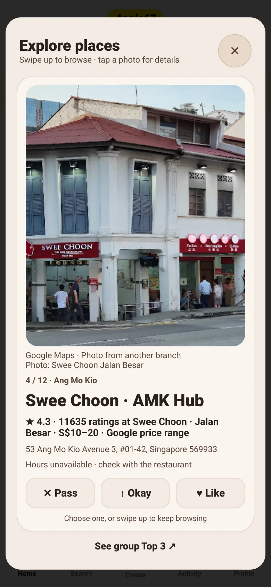 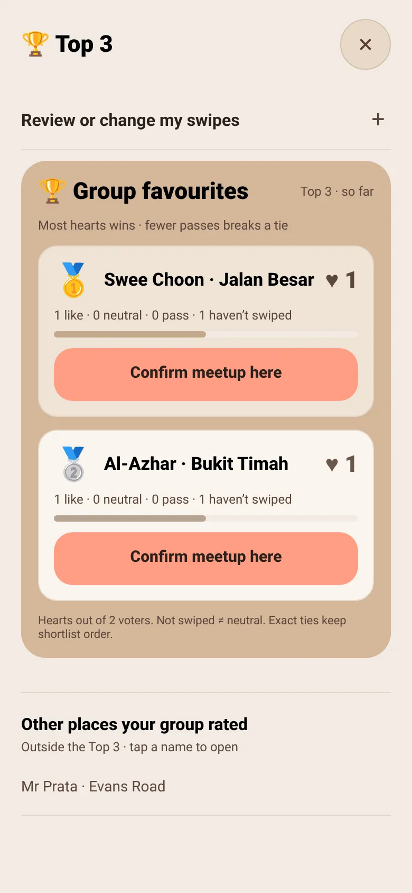 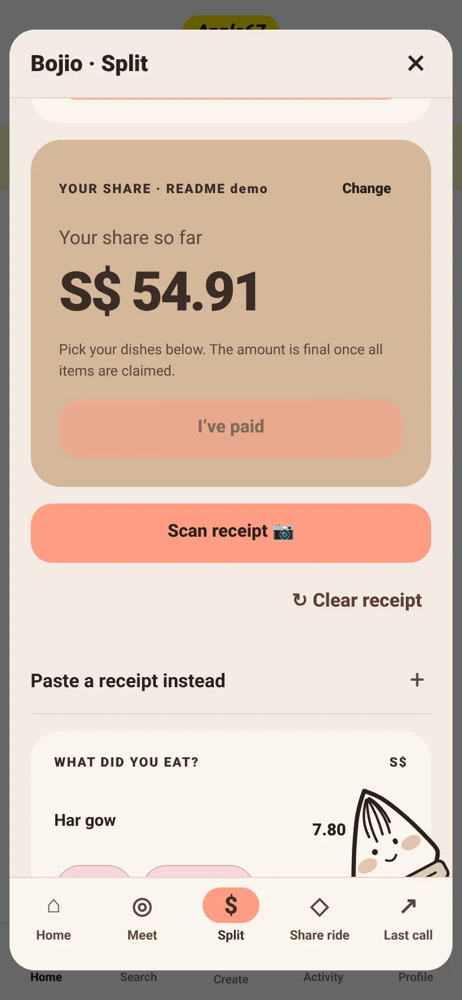

<sub>Real screenshots of the [live demo](https://autonomous-sg.vercel.app) at phone size. Feed posts are labelled demo content; photos from Unsplash.</sub>

</div>

---

## Great places deserve more than a screenshot

You find a cafe on Lemon8 or Xiaohongshu. You screenshot it. You send it to the Telegram group.

“Anyone wants to go?”

Someone suggests another place. Three more screenshots arrive. Half the group hasn't replied. Nobody knows which option everyone actually likes. The recommendation gets buried, and the outing never gets decided.

**Discovery creates the desire. Coordinating the group is where that desire gets lost.**

For friends, that means more admin before a simple meal. For a restaurant, it means interest that may never become a visit. When the conversation moves from a post to a screenshot to a private chat, the connection between discovery and a group decision becomes difficult to follow.

Apple67 keeps the outing together, from the first “jio?” to the last person heading home.

## What it does

| | Step | What happens |
|---|---|---|
| 🎉 | **Party** | Start a party with a name. Share a link or code. Friends join with no account. |
| 👆 | **Makan Swipe** | Everyone swipes the same restaurant deck. Likes become a live Top 3. The host confirms. |
| 🚗 | **Same Way, Can Share?** | Riders going the same way are grouped, drop-offs are ordered, and the fare is split. |
| ⏱️ | **Last Call** | One group leave-by countdown before the last trains. |
| 🧾 | **SplitLink** | Scan the receipt. Friends claim their dishes. Service charge and GST are shared out to the cent. |

## See it in action

Screenshots taken from the live demo with a throwaway party.

| **1 · For You feed** | **2 · Bao menu** | **3 · Create a party** | **4 · Invite** |
|---|---|---|---|
|  | 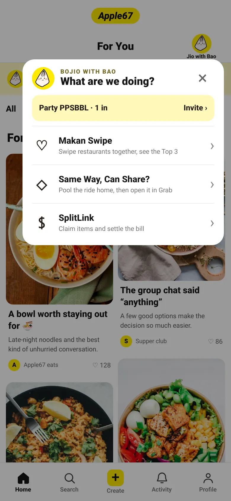 | 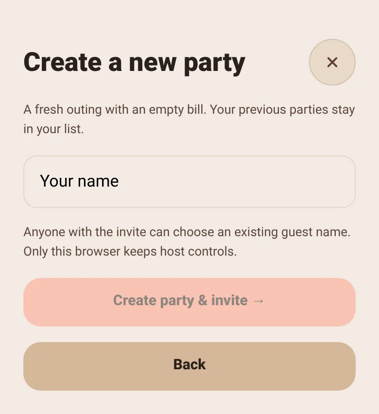 | 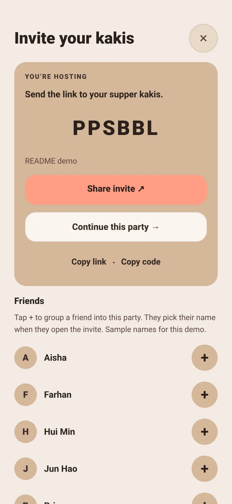 |
| Scroll ideas, then tap **Jio with Bao** to turn one into a plan. | One menu for the whole night: swipe, ride, split. | Just a name. No account, no sign-up. | Share a link or six-letter code. Friends pick their name. |

| **5 · Meet** | **6 · Swipe to pick** | **7 · Live Top 3** | **8 · Last Call** |
|---|---|---|---|
| 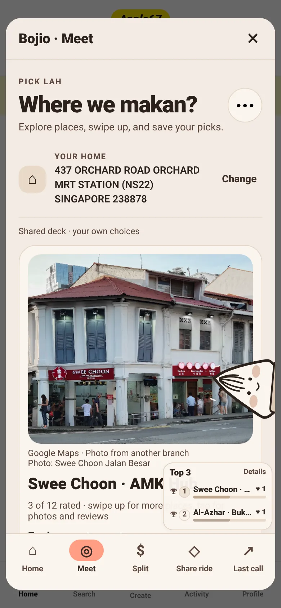 |  |  | 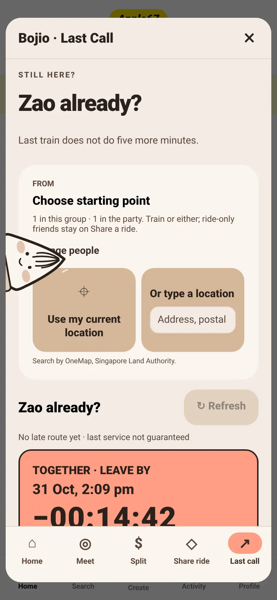 |
| Set your home, then open the shared restaurant deck. | Pass, Okay or Like on real Google Places venues, with photos and ratings. | Most hearts wins. The host confirms the meetup. | One leave-by countdown for the group. |

| **9 · Share ride** | **10 · Split: confirm total** | **11 · Split: claim dishes** |
|---|---|---|
| 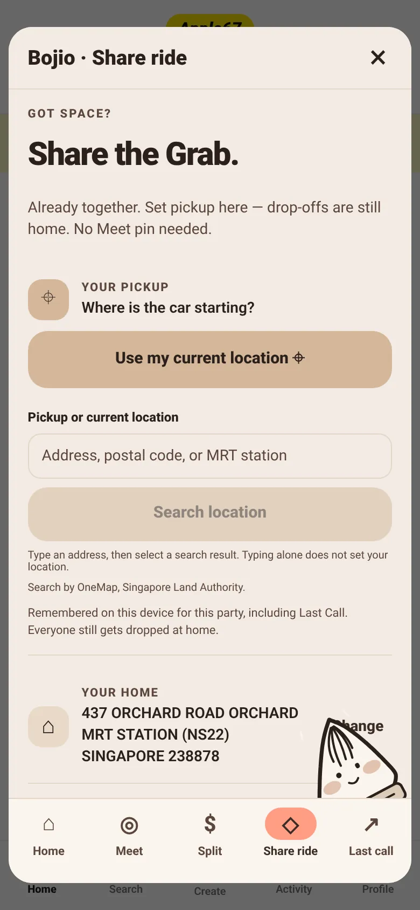 | 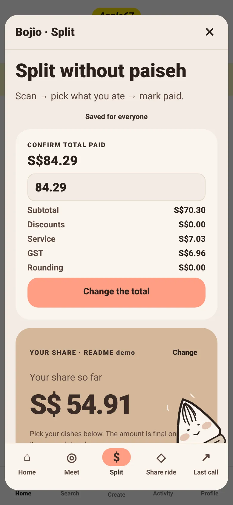 |  |
| Set a pickup. Riders going the same way are grouped and drop-offs ordered. | Host confirms the total paid, with service charge and GST. | Everyone claims what they ate. Shares add up to the cent. |

<sub>Last Call needs a start point and route data. In the screenshot it is taken in the afternoon, so the countdown reads overdue. The Share ride result needs two people with home addresses, so only the setup screen is shown.</sub>

## How a night out works

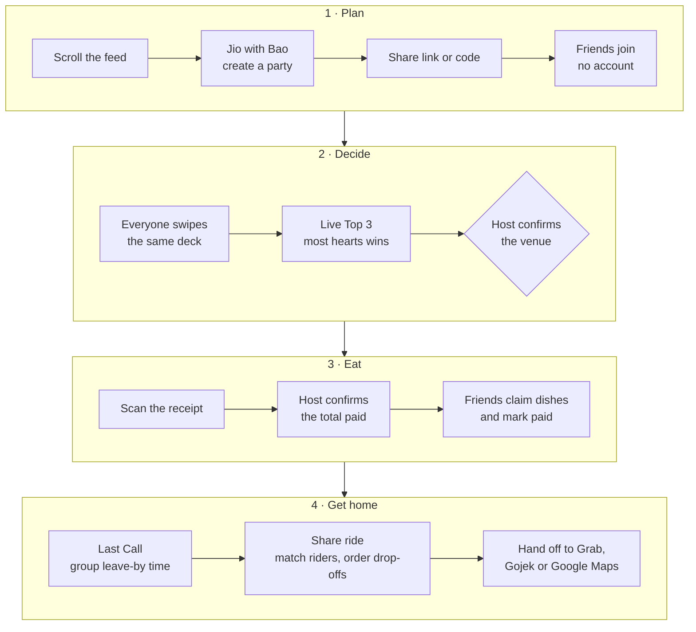

## One party, three jobs

### 1. Makan Swipe — turn “anything lah” into a decision

Start a party, share a link, and let everyone swipe on the same restaurant deck. Likes become a live **Top 3**. The host confirms the group's destination.

The familiar swipe makes contributing easy. The shared ranking makes the result visible. Friends can keep chatting in Telegram while Apple67 holds the plan.

**Built today:** shared parties, restaurant candidates, group swipes, a transparent ranking and host confirmation. The discovery feed links into party creation; its posts are illustrative and do not yet seed the restaurant deck.

**Next:** add places from saved posts or user suggestions, then personalise candidates using the party's preferences. Community posting and sponsored venue discovery belong to this next stage.

### 2. Same Way, Can Share? — make getting there part of the plan

Imagine ten friends leaving supper. Instead of ten people separately working out transport, Apple67 groups compatible riders, orders their drop-offs and splits an entered fare. Public-transport riders get a shared Last Call countdown.

**Built today:** ride-home matching for cars of up to four people, bounded detours, fare splitting and handoffs to Grab or Google Maps. Gojek can be opened from the app. The matching prioritises getting more people sharing, then smaller detours and shorter driving time; it does not compare live fares or guarantee the cheapest booking.

**Next:** coordinate travel to the venue as well as home, and explore partner referral links or group offers. Discounts and commercial partnerships require agreements with the providers.

### 3. SplitLink — finish dinner without starting another spreadsheet

Photograph the receipt. Review the extracted items. Friends open the party link and claim what they ate. Service charge, GST and shared items are allocated, with totals that reconcile to the cent.

**Built today:** receipt scanning, collaborative item claims and manual payment-status confirmation, without requiring guests to create accounts. Actual payments happen outside Apple67.

**The whole evening stays connected:** the people who chose the venue are already there when it is time to share a ride or settle the bill.

## Architecture

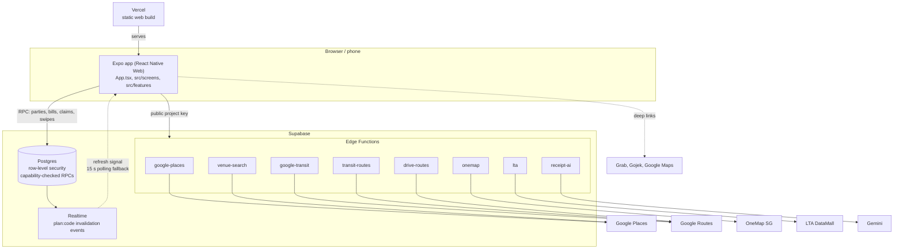

Provider keys live in Edge Function secrets, so none reach the app bundle. Guests never touch tables directly: every read and write goes through a database function that checks a capability token (see [`supabase/README.md`](supabase/README.md)).

## Tech stack

| Layer | Choice |
|---|---|
| App | [Expo](https://expo.dev) 54, React 19, React Native 0.81, React Native Web, TypeScript |
| Hosting | Vercel (static `dist` export; see [`vercel.json`](vercel.json)) |
| Database and realtime | Supabase Postgres with row-level security, 30 migrations, Realtime |
| Backend logic | Supabase Edge Functions (Deno) |
| Data providers | Google Places and Routes, OneMap, LTA DataMall |
| Receipt scanning | Google Gemini, called only from the `receipt-ai` function |
| Tests | Vitest unit tests, Playwright verification scripts in [`scripts/`](scripts) |

## Quick start

Requires Node.js 22+. Expo Go is optional, for running on a phone.

```bash
npm install
npm run web    # then open http://localhost:8081/#discover
npm start      # or scan the QR code with Expo Go
npm test       # unit tests
npm run typecheck
```

For the web demo, open `http://localhost:8081/#discover` after `npm run web`. The feed posts and profile/activity are illustrative; Search filters posts, post details can be liked locally, and Create previews a post without publishing it. Tap **Jio with Bao** to open its drop-down. With no party the only option is **Create party**, which leads to the invite page: copy the link, or tap + on a sample friend to add them to the roster. Go back and tap Bao again for **Makan Swipe**, **Same Way, Can Share?** (the Grab handoff) and **SplitLink**. You can also tap **Jio friends with Bao** on a post to start a party whose invite leads with that post. Posts are illustrative, so they do not filter the restaurant shortlist. Shared plans, group votes, bills and journeys use the existing Bojio flows.

### Connect a backend

The feed and local drafts work without any setup. Shared parties, restaurant search, scanning and routing need cloud services.

1. Create a Supabase project and run [`supabase/demo-setup.sql`](supabase/demo-setup.sql) once in the SQL Editor of the new, empty project.
2. Copy `.env.example` to `.env.local`, add the project URL and publishable key, then restart Expo. Never put a service-role key in the app.
3. Deploy the Edge Functions you need and set their secrets in Supabase.

| Variable | Where | Purpose |
|---|---|---|
| `EXPO_PUBLIC_SUPABASE_URL` | `.env.local` | Supabase project URL |
| `EXPO_PUBLIC_SUPABASE_PUBLISHABLE_KEY` | `.env.local` | Public client key (`EXPO_PUBLIC_SUPABASE_ANON_KEY` is the legacy fallback) |
| `EXPO_PUBLIC_SUPABASE_FUNCTIONS_URL` and `_KEY` | `.env.local` | Optional. Edge Functions on a different project. Set both or neither |
| `EXPO_PUBLIC_APP_URL` | `.env.local` | Public web origin used in share links |

| Function | Secret | Used for |
|---|---|---|
| `google-places` | `GOOGLE_PLACES_API_KEY` | Restaurants, details and photos |
| `google-transit` | `GOOGLE_ROUTES_API_KEY` | Public transport routes |
| `venue-search`, `transit-routes`, `drive-routes` | `GOOGLE_MAPS_API_KEY` | Venue text search, transit and driving routes |
| `onemap` | `ONEMAP_EMAIL`, `ONEMAP_PASSWORD` | Address search, driving and fallback transit |
| `lta` | `LTA_DATAMALL_ACCOUNT_KEY` | Last services and bus arrivals |
| `receipt-ai` | `GEMINI_API_KEY` | Receipt scanning |

See [`supabase/README.md`](supabase/README.md) for the security model and [`docs/FREE-SERVICE-SETUP.md`](docs/FREE-SERVICE-SETUP.md) for a free-tier walkthrough. Server-side variables for local development go in `.env.server` (see [`.env.server.example`](.env.server.example)); never commit it.

## Deploy

The web app is a static export, hosted on Vercel.

1. Import the repository in Vercel. [`vercel.json`](vercel.json) sets the build command (`npm run build:vercel`) and output directory (`dist`).
2. Set `SUPABASE_URL` and `SUPABASE_PUBLISHABLE_KEY` in the Vercel project. Add `SUPABASE_FUNCTIONS_URL` and `SUPABASE_FUNCTIONS_KEY` if the functions live on a separate project. The build maps these to the `EXPO_PUBLIC_` variables.
3. Deploy. Locally, `npm run build:web` produces the same `dist` folder.

## Project structure

```text
App.tsx              App shell and navigation
src/screens/         One file per core flow
src/components/      Shared UI, swipe deck, receipt scanner
src/features/        Pure logic for meeting, splitting, rides, trains
src/data/            Local drafts, Supabase and provider adapters
supabase/            Database setup, migrations and Edge Functions
scripts/             Verification and dev scripts
docs/                Product notes, verification records, README images
```

Older docs and the package name still use the working name, Bojio.

## The business opportunity: help interest become action

A restaurant benefits when a group chooses to visit. A transport provider benefits when that group needs a ride. Apple67's opportunity is to connect those moments while giving friends a useful, free coordination tool.

| Moment | Value for the group | Proposed commercial model |
|---|---|---|
| Discover a place | Relevant ideas for the next outing | Clearly labelled sponsored venue posts or placements |
| Choose together | A shortlist the group can act on | Opt-in venue offers or booking referrals, subject to merchant agreements |
| Travel together | Compatible ride groups and a convenient handoff | Transport referral fees or partner-funded discounts, subject to provider agreements |

**These are business hypotheses, not existing revenue or partnerships.** The current build has no paid placements, affiliate tracking, negotiated discounts or booking integration.

Our proposed rule is simple: sponsorship must be visible, and payment must not secretly change the group's vote ranking. Users should be able to see why a place won. Merchant reporting would need opt-in, aggregate measurement; selecting a venue alone is not proof of a visit or sale.

The model to validate is whether partner revenue from completed, attributable actions can cover the service costs in [the operating-cost model](#6-before-and-after). A free consumer experience needs sustainable economics behind it.

### Start with supper. Expand to shared outings.

Food gives us a clear first use case: discover, decide, travel and settle. The same party workflow could later support fashion shops, camera stores, equipment shopping and other outings friends plan together. Those categories are a roadmap, not current product coverage.

## Built for Autonomous SG 2026

We reconstruct the user-facing workflows of closed discovery, bill-splitting and transport products, then connect them in reusable, MIT-licensed code. Our reverse-engineering evidence is observable behaviour, documented interfaces, data inspection and experiments; we do not claim access to proprietary recommendation algorithms.

The competition asks: **“What did you uncover, and how do you know it works?”** [Section 4](#4-what-we-uncovered) records the findings. [Section 3](#3-where-incumbents-fail) links them to the repository's recorded verification. The evidence below comes from existing project records; this README rewrite did not rerun the live checks.

| Rubric criterion | Weight | Our best evidence | Section |
|---|---|---|---|
| Cost of the status quo | 20% | A named paid target: Splitwise Pro receipt scanning and itemisation; wider outing and restaurant marketing costs shown separately | [1](#1-the-old-thing-the-group-eat-out-stack) |
| Reach of the old thing | 15% | Grab 53.9M monthly users, Xiaohongshu 300M+, Lemon8 about 23.4M, Splitwise tens of millions registered | [2](#2-reach-of-the-old-thing) |
| Coolness of the new build | 25% | Receipt photo to dishes claimed on friends' phones, no account, then exact ride matching and a group last-train countdown | [5](#5-where-apple67-delivers) |
| Cost reduction | 25% | Free receipt splitting versus the recorded paid-plan benchmark; explicit API operating-cost assumptions | [6](#6-before-and-after) |
| Open source licensing | 15% | MIT license, public repo, full database setup in one file | [8](#8-open-source) |

Savings apply to the workflow we replace. Delivery subscriptions, restaurant deals and ride fares remain separate expenses. [Known limits](#7-known-limits) make the current scope explicit.

## Contributing

Keep each change small enough to test. Run `npm run typecheck` and `npm test` before opening a pull request, and check the changed flow on a narrow phone viewport. Replace mock claims with live data only when the source and timestamp are visible. Update [`docs/PRODUCT.md`](docs/PRODUCT.md) when product scope changes. See [`CONTRIBUTING.md`](CONTRIBUTING.md) for how to write a good prompt for AI-assisted changes.

## License

[MIT](LICENSE). See [Open source](#8-open-source) for what the license covers.

---

## Submission evidence

The sections below are the project's evidence for the Autonomous SG 2026 rubric. The numbers in the rubric table link here.

## 1. The old thing: the group eat-out stack

A friend group uses a different product for each step, and each one costs money, time or lock-in.

| Step | Product today | What it costs | Apple67 |
|---|---|---|---|
| Discover | Lemon8, Xiaohongshu | S$0 in money. You pay with [ads in the feed and search](https://ads.tiktok.com/help/article/about-lemon8-in-tiktok-ads-manager) and a ranking you can't inspect | Partly replaced |
| Find deals | Burpple Beyond | [S$79](https://burpple-web.burpple.com/sg) (promotional) to [S$99](https://www.ocbc.com/iwov-resources/sg/ocbc/personal/pdf/campaign/digital-banking/tnc-governing-the-ocbc-pay-anyonetm-burpple-beyond-membership-activation-campaign-apr-to-may-2022.pdf) (2022 retail) a year | Not covered |
| Decide | WhatsApp group | Time, and one person doing the admin. Not yet measured | Replaced |
| Order in | GrabFood with GrabUnlimited | [S$5.99 a month or S$59.88 a year](https://www.grab.com/sg/grabunlimited/), plus order fees | Not covered |
| Split the bill | Splitwise Pro | [US$59.99 a year, US$7.99 a month, or US$89.99 a year for Duo](https://apps.apple.com/app/splitwise-bill-splitter/id458023433) | Replaced |
| Ride home | Grab | The fare, plus a [platform fee raised S$0.30 from January 2026](https://malaymail.com/news/singapore/2025/12/24/grab-to-raise-ride-platform-fee-in-singapore-adding-30-cents-from-jan-1/203067) | Coordinated, not replaced |
| Last train | Google Maps | Free, but it plans one person's journey at a time | Replaced for groups |

Using the price benchmarks recorded for this submission, someone paying for all three subscriptions would spend **S$18–24 a month**: Burpple Beyond at S$79–99 a year, GrabUnlimited at S$59.88–71.88 a year, and Splitwise Pro at S$76.79–122.73 a year. That converts at US$1 = S$1.28, the rate on 28 October 2026.

That figure is the status quo, not our saving. Section 6 separates the two.

### The restaurant's side: the cost of being discovered

Feeds are free for diners because businesses pay to be seen in them. That makes discovery a second expensive old thing.

**Xiaohongshu platform fees**

| Fee | Amount | Source |
|---|---|---|
| Business account verification ("Blue V") | RMB 600 a year, not refunded if rejected. Open to companies in Singapore and Malaysia | [The Red Scroll](https://www.theredscroll.com/insights/xiaohongshu-business-account-setup/), [The China Path](https://www.thechinapath.com/insights/china-social-media-marketing-cost-per-month) |
| Creator deals through Pugongying, its official creator marketplace | Creator's price plus a 10% platform fee. Paid deals outside Pugongying are prohibited | [The China Path](https://www.thechinapath.com/insights/china-social-media-marketing-cost-per-month), [Jademond](https://www.jademond.com/guides/rednote-marketing) |
| In-app shop commission | 5–8% once monthly sales pass RMB 10,000 | [Prizm Digital, January 2025](https://prizmdigital.co.nz/xiaohongshu-e-commerce-shop-guide/), may be outdated |
| Self-serve post boost | From RMB 75 an order | [The Red Scroll](https://www.theredscroll.com/insights/xiaohongshu-marketing-cost/) |
| App-open splash ads | RMB 80–150 per 1,000 impressions, with a RMB 100,000–300,000 minimum per campaign | [Hashmeta](https://hashmeta.com/blog/xiaohongshu-marketing-costs-complete-budget-breakdown-for-brand-success/) |

**Creator fees per post**

| Creator size | Followers | Singapore | Malaysia |
|---|---|---|---|
| Nano | 1K–10K | S$150–500 | RM200–800 |
| Micro | 10K–50K | S$500–2,000 | RM800–3,500 |
| Mid-tier | 50K–500K | S$2,000–8,000 | RM3,500–15,000 |
| Macro | 500K–1M | S$8,000–20,000 | RM15,000–35,000 |

These are rate cards from [Hashmeta Singapore](https://hashmeta.com/blog/xiaohongshu-influencer-pricing-singapore-complete-guide-for-brands/) and [Hashmeta Malaysia](https://hashmeta.com/blog/xiaohongshu-influencer-pricing-malaysia-complete-rate-guide-budget-calculator/), an agency that sells influencer marketing, so treat them as estimates.

**Typical monthly budgets**

- **China:** about RMB 66,500 in [The China Path's own model](https://www.thechinapath.com/insights/china-social-media-marketing-cost-per-month), made up of four creator posts (RMB 47,500), ads (RMB 10,000) and one staff member (RMB 9,000).
- **Malaysia:** about RM3,000–5,500 for a small business, according to [ZenWeb](https://zenweb.my/blog/xiaohongshu-ads-malaysia/), a local agency.

**Lemon8**

- **Ads:** sold through TikTok Ads Manager in six markets: the US, Japan, Thailand, Singapore, Malaysia and Indonesia. We found no published price per 1,000 views.
- **Verification:** we found no fee.
- **Creators:** there's no creator fund or open revenue share. An invitation-only program reportedly pays about US$10 per approved post, based on creators' own reports rather than an official rate card.

Source for all three: [MakeInfluence](https://www.makeinfluence.com/en/academy/lemon8-as-an-influencer-marketing-channel-whats-there-in-2026).

**What it adds up to.** A Singapore restaurant pays about S$500–2,000 for one micro-creator post on Xiaohongshu, or about S$550–2,200 by our calculation once the 10% platform fee is added. On delivery orders, GrabFood also takes [18–25% commission](https://klikit.io/zh-CN/learn/food-delivery-commission-fees-singapore-guide), according to a guide from a restaurant software vendor that cites no source. Apple67 has no paid placement: restaurants reach a group through Google's listings and friends' swipes, and pay S$0 to appear.

**How reliable this is.** The verification and Pugongying fees are reported by agencies citing Xiaohongshu's help centre. Creator rates are agency estimates, and Lemon8 creator pay is self-reported.

## 2. Reach of the old thing

| Product | Usage signal | Source | Confidence |
|---|---|---|---|
| Grab | 53.9M group monthly transacting users, Q2 2026, across Southeast Asia | [Grab Q2 2026 results](https://www.sec.gov/Archives/edgar/data/0001855612/000185561226000123/a2026q2-earningspressrelea.htm) | High |
| Xiaohongshu | 300M+ monthly users; 70% searched on it at the end of 2023 | [KrASIA, August 2024](https://amp.kr-asia.com/xiaohongshu-can-chinas-wildly-popular-app-raise-its-profit-game) | Medium |
| Xiaohongshu, Malaysia and Singapore | 4.3M users combined | [Publicis Media strategist in Marketing-Interactive, June 2025](https://www.marketing-interactive.com/unlocking-the-4-3-million-opportunity-on-xiaohongshu-for-malaysia-and-singapore); no underlying source given | Low |
| Lemon8 | About 23.4M monthly users worldwide in March 2026; 16M+ in March 2025 | [Third-party estimate](https://www.amraandelma.com/lemon8-marketing-statistics/), [Statista](https://www.statista.com/statistics/1546838/lemon8-mau-worldwide-by-app-store) | Low to medium |
| Splitwise | Tens of millions of registered users (2021); 10M+ Google Play downloads | [Company statement via Yes Press](https://yespress.io/splitwise-inc), [AppBrain](https://www.appbrain.com/app/splitwise/com.Splitwise.SplitwiseMobile) | Medium, dated |
| WhatsApp | Singapore's favourite social app | [Digital 2024, We Are Social](https://campaignbriefasia.com/?p=156949) | Medium |
| Burpple | About 1M monthly users in Singapore (2018) | [Vulcan Post](https://vulcanpost.com/642094/burpple-beyond-1-for-1-singapore) | Low, old |
| Food delivery | US$2.9B Singapore GMV in 2025 | [Momentum Works via Asia News Network](https://asianews.network/?p=253855) | Medium |

We found no published figure for how many Lemon8 users look at food. Food is a main browsing category there, but we don't claim a food-user number.

**Why group decisions matter.** In a [survey of 1,021 Singaporeans](https://sevenrooms.com/press/over-half-of-singaporeans-rely-on-social-media-to-discover-new-restaurants/) in March 2023, 71% said they find new restaurants through friends and family, ahead of restaurant social pages (52%) and influencers (43%). A [2025 survey of 510 adults in Hong Kong and Singapore](https://www.marketing-interactive.com/singapore-consumers-trust-peers-over-brands-on-xiaohongshu) found Xiaohongshu users trust regular users (46.6%) more than influencers (30.3%) or brands (22.9%). Only 21.7% of those respondents used Xiaohongshu at all.

## 3. Where incumbents fail

| Job | Where it fails | Where Apple67 delivers | Proof today |
|---|---|---|---|
| Discover | Moving a recommendation into a separate group chat loses the shared planning context | One tap from the feed into a shared party | 12 labelled demo posts. Real restaurant candidates come from Google |
| Get discovered (restaurants) | Visibility is bought post by post, at about S$550–2,200 for one micro-creator post on Xiaohongshu | No paid placement. Friends' swipes decide a group's Top 3 | No paid-placement code in this repository. Candidates still start from Google's listings |
| Decide | Screenshots and replies scatter preferences; one person often has to consolidate the answer | Everyone swipes the same deck, a live Top 3 updates, and the host confirms | Two separate sessions passed voting and host confirmation on the public URL against the real database |
| Split | Receipt scanning and itemising [sit behind Splitwise Pro](https://www.splitwise.com/pro). Users report a free-tier cap of 2 to 5 expenses a day, which Splitwise doesn't publish | Scan the receipt, friends claim dishes with no account, shares add up to the cent | Two public sessions passed claims, offline retry and paid status. A synthetic English and Chinese receipt read 10% service, 9% GST and the 8.39 total in 5.1 seconds |
| Ride | Someone works out who shares and the drop order, then enters the stops by hand | Pairs riders, orders drop-offs, splits the entered fare, and opens Grab or Google Maps | A deployed test required all four real driving legs. The Grab link was tested as a URL, not on a physical phone |
| Last train | Everyone checks alone, and the group finds out too late who has to leave | One leave-by time for the group, checked against LTA service data | A public Orchard to Tampines check produced a full group countdown. A real OneMap and LTA mismatch paused the countdown until a valid route was found |

**Discover.** Lemon8 sells [ads in its For You feed and search results](https://ads.tiktok.com/help/article/about-lemon8-in-tiktok-ads-manager), and [Singapore is a listed market](https://ads.tiktok.com/help/article/about-lemon8-for-brand-auction-in-tiktok-ads-manager). On Xiaohongshu, a [2023 report](https://www.theworldofchinese.com/2023/03/the-shady-world-of-chinese-online-reviews/) described ghostwritten posts for as little as 4 yuan and a user who struggled to tell paid posts from genuine ones. In 2021 the company [apologised for heavily filtered travel reviews](https://technode.com/2021/10/18/xiaohongshu-apologizes-for-misleading-travel-reviews/) after a hashtag drew 400M views. Neither report is specific to food, but both show the trust gap that friends' recommendations close.

**Split.** Splitwise is built for running balances, and it does that well. The gap is the moment at the table: a paper receipt, several people, and a scan feature behind a subscription. Apple67 treats that moment as the whole product.

**Ride and last train.** The ride app and the map each see one person. Neither knows the group's plan, so the coordination falls to whoever is most organised. Apple67 starts from the group and works out each person's journey from there.

## 4. What we uncovered

| System | What we found | How we know | What we did with it |
|---|---|---|---|
| Tinder-style swiping | A swipe is a fast, low-effort vote, but requiring everyone to agree can leave a group with no answer | Our own design and tests | The group [ranks by likes, then fewer passes, then deck order](src/features/meet/swipes.ts), and the host confirms |
| Lemon8 and Xiaohongshu feeds | We can't see their ranking code and don't claim to. We can see the layout and where ads go | Screenshots of the app; TikTok's ad documentation | Rebuilt the two-column feed as a way into a plan. Our vote ranking is one readable function, though candidates still start from Google's popularity order |
| Grab links | `grab://open?screenType=BOOKING` accepts one pickup and one drop-off. We found no documented multi-stop option. `gojek://` only opens the app. grab.com itself routes links through `grab.onelink.me` | [Our link builder](src/features/rides/rideLinks.ts); grab.com page source | Hand off what the link supports, copy the remaining stops, and offer a full Google Maps route |
| Splitwise's paywall | Scanning is a selling point of Pro, yet a model call now reads a receipt for under a cent | [Pro page](https://www.splitwise.com/pro); [our scan function](supabase/functions/receipt-ai/index.ts) with Google's listed prices | Made scanning free, including discounts, service charge, GST, and English and Chinese receipts |
| Singapore transit data | OneMap returned a bus after LTA's published last service. Transit requests also returned walking-only results and timeouts | Live checks in [`REMOTE_HANDOFF.md`](REMOTE_HANDOFF.md) and [`docs/LIVE-VERIFICATION.md`](docs/LIVE-VERIFICATION.md) | Google Routes first, OneMap as fallback, and LTA as a cross-check. If a route fails the check, the countdown stops |
| LTA train archive | 17,576 trips, 333,262 stop times, 1,211 stops, 19 routes and 12 service calendars | We downloaded and inspected the archive | Match dated trips and stops, and refuse to guess when data is ambiguous |
| Google Places terms | Most place content can't be stored long term | [Google's policies](https://developers.google.com/maps/documentation/places/web-service/policies) | Save only place IDs. Names, ratings and hours stay in session memory |

## 5. Where Apple67 delivers

**The demo: one group, one complete evening**

1. Open the feed, tap a post and create a party with just a name.
2. Share the link. A friend joins by choosing a name, with no account.
3. Both swipe the same restaurant deck while the Top 3 updates. The host confirms the venue.
4. At the table, photograph the receipt. Items, service charge and GST appear for review.
5. Each person claims their dishes and taps "I've paid". The host confirms receipt.
6. Share ride pairs people going the same way, orders the drop-offs, splits the fare and opens Grab.
7. Last Call shows one group leave-by countdown before the trains stop.

**What makes it work**

- **Exact ride matching.** [`actualRides.ts`](src/features/rides/actualRides.ts) tries every group of up to four riders and every drop order, and rejects any order that adds more than 15 minutes to someone's trip. A memoised search then gets the most people sharing, followed by the smallest worst detour and the shortest total drive.
- **Money that adds up.** [`calculateBill.ts`](src/features/split/calculateBill.ts) works in integer cents and hands out leftover cents by largest remainder, so shares always match the bill total.
- **Payment status tied to the amount.** If a bill changes, [an earlier "paid" stops counting](src/features/split/settlements.ts), so nobody is marked settled for an old total.
- **A receipt reader that won't guess.** The scanner treats the image as untrusted, ignores instructions printed on it, keeps prices with their own dishes, and never invents a balancing row. People review the result before it joins the bill.
- **Guests without accounts, safely.** Tables deny direct access. Guests go through capability-checked database functions, and the host token never appears in an invite link.
- **No invented numbers.** If a route, hour or fare can't be confirmed, the app shows nothing reassuring in its place. A group countdown only appears when every public-transport rider has a valid route.

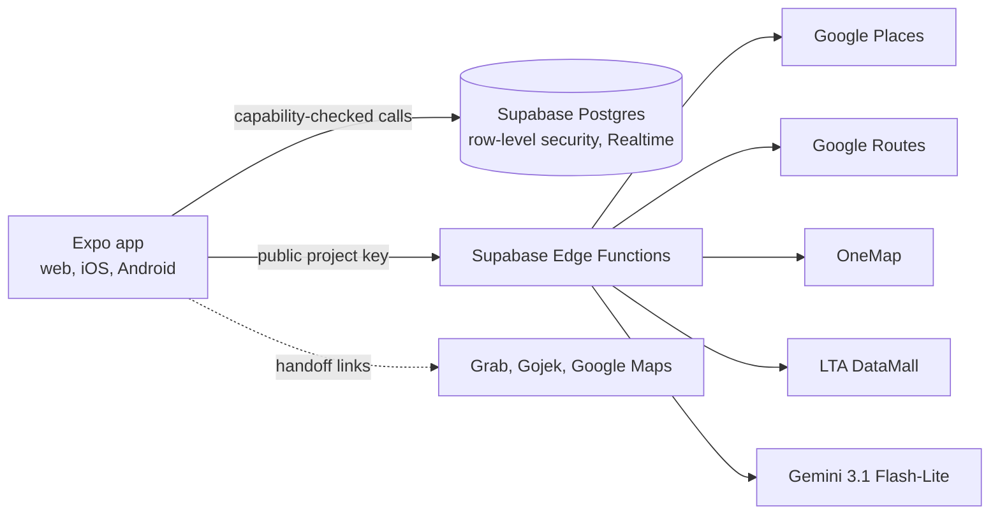

Provider keys stay in Edge Functions, so none of them reach the app bundle.

## 6. Before and after

**For users.** The current Apple67 build is free to use, with no subscription or ads; guests join without accounts. Proposed sponsored discovery is future work.

The comparisons below retain the submission's recorded price benchmarks, not a fresh regional checkout quote. Splitwise's official Pro page confirms scanning and itemisation are paid features; its App Store pricing could not be independently rechecked during this rewrite. Confirm the target region's price before presenting these savings. Savings apply to someone who would otherwise pay for that workflow, not every free-tier user.

| Item | Before | With Apple67 | Saving we claim |
|---|---|---|---|
| Receipt scanning and itemised splits | Splitwise Pro, S$77 a year (annual) to S$123 a year (monthly) | S$0 | **S$77–123 a year** |
| Dining deals | Burpple Beyond, S$79–99 a year | Unchanged | None. We offer no deals |
| Delivery | GrabUnlimited, S$60–72 a year | Unchanged | None. We don't order food |
| Group admin | Unmeasured | Unmeasured | None yet |

Splitwise Pro also includes things we don't, such as charts, currency conversion and running balances, so this compares the at-the-table job only.

**For restaurants.** Appearing in Apple67 costs S$0, against about S$550–2,200 for one micro-creator post on Xiaohongshu. We don't count this as a saving, because a paid post buys reach that Apple67 doesn't have yet.

**For whoever runs it.** Free to use isn't the same as free to run. These are the provider prices we checked on 31 October 2026, after each monthly free allowance:

| Provider call | When it happens | List price | Four people, 20-card deck |
|---|---|---|---|
| Google Nearby Search | Once per search | US$0.035 | US$0.035 |
| Google Place Details | Each guest, each card | US$0.02 | 60 calls, US$1.20 |
| Google Place Photos | Each person, each card | US$0.007 | 80 calls, US$0.56 |
| Google Routes, at the Essentials rate | Up to 8 checks a person | US$0.005 | 32 calls, US$0.16 |
| Gemini 3.1 Flash-Lite | Each receipt | Under US$0.01 | Under US$0.01 |
| **Worst case for one outing** | | | **About US$2, or US$0.50 a person** |

That worst case assumes everyone views every card. Google's free allowance of 1,000 Place Photos calls a month runs out first, after about 12 of those outings. OneMap and LTA DataMall are free, and the web app and database run on free tiers.

The scan ceiling comes from the code. The function caps output at 4,096 tokens, which costs US$0.0061 at [US$1.50 per million](https://ai.google.dev/gemini-api/docs/pricing), and input at US$0.25 per million adds a fraction of that. Someone scanning twice a week would cost about US$1 a year at that ceiling, against US$59.99 for Splitwise Pro.

## 7. Known limits

- **No ordering, deals or bookings.** Apple67 is for eating out. It doesn't place delivery orders, offer discounts or reserve tables.
- **One bill at a time.** Guests pay the host for each bill. There are no running balances across bills and no debt simplification.
- **No real payments.** "Sent" and "received" are manual status updates.
- **Rides aren't booked.** The Grab link carries one pickup and one drop-off, so other stops are entered by hand. The Gojek link only opens the app. Neither handoff has been tested on a physical phone.
- **Last Call has no guarantee.** It shows the latest journey found by a bounded search of up to 8 checks a person, which isn't proof of the final service. Planned closures and holiday extensions aren't fully covered.
- **No real-world scan accuracy figure.** Receipt scanning has been tested on synthetic receipts. Photos are sent to Google Gemini.
- **The feed is a demo.** It holds 12 illustrative posts, with no user posting or personalised ranking.
- **Restaurant candidates aren't fully open.** Group ranking is public code, but the initial list comes from Google.
- **Not a marketing channel.** Restaurants can't add or manage a listing, and Apple67 doesn't yet have an audience to compare with these platforms. There's no paid placement today, though [`docs/PRODUCT.md`](docs/PRODUCT.md) lists clearly labelled sponsorship as a possible later model.
- **Open party access.** Anyone with the link or code can pick an existing guest name, so invites should go to people you trust. Parties hold up to 12 people, and a car takes four riders.
- **Limited device testing.** Most checks ran in phone-sized browsers rather than on physical phones.
- **Time saved isn't measured.** We have no number yet for how long a group spends deciding.
- **The hosted version depends on free tiers.** Google and Gemini calls are metered, so the demo may be rate-limited or paused.
- **The older public pilot is behind this repository.** [bojio.pages.dev](https://bojio.pages.dev) serves an earlier build under the working name Bojio, without the discovery feed. The [live demo](https://autonomous-sg.vercel.app) serves the current build.
- **Market figures have limits.** Many are third-party estimates or several years old, and creator rates are agency estimates. Section 2 rates the usage figures, and Splitwise's regional pricing may differ.

## 8. Open source

- **License:** [MIT](LICENSE). Anyone can use, change and redistribute the code.
- **Repository:** [github.com/vrisdng/autonomous-sg](https://github.com/vrisdng/autonomous-sg), public.
- **Self-hosting:** [`supabase/demo-setup.sql`](supabase/demo-setup.sql) sets up the whole database from one file, covering all 30 migrations.
- **Reusable parts:** [bill splitting](src/features/split/calculateBill.ts), [ride matching](src/features/rides/actualRides.ts), [swipe ranking](src/features/meet/swipes.ts) and the [receipt scanner](supabase/functions/receipt-ai/index.ts) work on their own.

The MIT license covers our code. Google, OneMap and LTA data stay under their own terms, and self-hosters need their own keys. Feed photos come from Unsplash.

## 9. Sources

Source register retained from the submission, originally marked checked 31 October 2026 unless a date is shown. This editorial revision reconfirmed Splitwise Pro feature availability, not every external statistic or price. Prices can vary by region.

**Prices**
- Splitwise: [App Store listing](https://apps.apple.com/app/splitwise-bill-splitter/id458023433) shows the three amounts; [Splitwise Pro](https://www.splitwise.com/pro) lists Pro features; [third-party notes on free-tier caps](https://getfinny.app/blog/splitwise-pricing-2026).
- GrabUnlimited: [Grab Singapore](https://www.grab.com/sg/grabunlimited/).
- Burpple Beyond: [Burpple promotion](https://burpple-web.burpple.com/sg), [OCBC terms, 2022](https://www.ocbc.com/iwov-resources/sg/ocbc/personal/pdf/campaign/digital-banking/tnc-governing-the-ocbc-pay-anyonetm-burpple-beyond-membership-activation-campaign-apr-to-may-2022.pdf). We couldn't confirm the current price.
- Grab platform fee: [Malay Mail, December 2025](https://malaymail.com/news/singapore/2025/12/24/grab-to-raise-ride-platform-fee-in-singapore-adding-30-cents-from-jan-1/203067).
- Exchange rate: [US$1 = S$1.28 on 28 October 2026](https://moneyexchangerate.org/currencyexchange/usd/sgd/6499), an aggregator rate.
- Provider costs: [Google Maps Platform pricing](https://developers.google.com/maps/billing-and-pricing/pricing), [Gemini API pricing](https://ai.google.dev/gemini-api/docs/pricing).

**Restaurant marketing costs**
- Xiaohongshu fees: [The Red Scroll on verification](https://www.theredscroll.com/insights/xiaohongshu-business-account-setup/), [The Red Scroll on marketing costs](https://www.theredscroll.com/insights/xiaohongshu-marketing-cost/), [The China Path](https://www.thechinapath.com/insights/china-social-media-marketing-cost-per-month), [Jademond](https://www.jademond.com/guides/rednote-marketing), [Prizm Digital](https://prizmdigital.co.nz/xiaohongshu-e-commerce-shop-guide/).
- Creator rates and ads: [Hashmeta Singapore](https://hashmeta.com/blog/xiaohongshu-influencer-pricing-singapore-complete-guide-for-brands/), [Hashmeta Malaysia](https://hashmeta.com/blog/xiaohongshu-influencer-pricing-malaysia-complete-rate-guide-budget-calculator/), [Hashmeta budget guide](https://hashmeta.com/blog/xiaohongshu-marketing-costs-complete-budget-breakdown-for-brand-success/), [ZenWeb](https://zenweb.my/blog/xiaohongshu-ads-malaysia/).
- Lemon8 creators and ads: [MakeInfluence](https://www.makeinfluence.com/en/academy/lemon8-as-an-influencer-marketing-channel-whats-there-in-2026).
- GrabFood commission: [Klikit, April 2026](https://klikit.io/zh-CN/learn/food-delivery-commission-fees-singapore-guide), a vendor guide.

**Usage**
- Grab: [Q2 2026 earnings release](https://www.sec.gov/Archives/edgar/data/0001855612/000185561226000123/a2026q2-earningspressrelea.htm).
- Xiaohongshu: [KrASIA](https://amp.kr-asia.com/xiaohongshu-can-chinas-wildly-popular-app-raise-its-profit-game), [Marketing-Interactive](https://www.marketing-interactive.com/unlocking-the-4-3-million-opportunity-on-xiaohongshu-for-malaysia-and-singapore).
- Lemon8: [marketing statistics, third-party estimate](https://www.amraandelma.com/lemon8-marketing-statistics/), [Statista](https://www.statista.com/statistics/1546838/lemon8-mau-worldwide-by-app-store).
- Splitwise: [Yes Press profile](https://yespress.io/splitwise-inc), [AppBrain](https://www.appbrain.com/app/splitwise/com.Splitwise.SplitwiseMobile).
- Others: [Burpple, Vulcan Post 2018](https://vulcanpost.com/642094/burpple-beyond-1-for-1-singapore), [WhatsApp, Digital 2024](https://campaignbriefasia.com/?p=156949), [food delivery, Asia News Network](https://asianews.network/?p=253855).

**Behaviour and trust**
- [SevenRooms and Antenna survey, March 2023](https://sevenrooms.com/press/over-half-of-singaporeans-rely-on-social-media-to-discover-new-restaurants/).
- [Digital Business Lab survey, May 2025](https://www.marketing-interactive.com/singapore-consumers-trust-peers-over-brands-on-xiaohongshu).
- [The World of Chinese, March 2023](https://www.theworldofchinese.com/2023/03/the-shady-world-of-chinese-online-reviews/), [TechNode, October 2021](https://technode.com/2021/10/18/xiaohongshu-apologizes-for-misleading-travel-reviews/).
- Lemon8 ads: [TikTok Ads Manager help](https://ads.tiktok.com/help/article/about-lemon8-in-tiktok-ads-manager), [Brand Auction availability](https://ads.tiktok.com/help/article/about-lemon8-for-brand-auction-in-tiktok-ads-manager).
